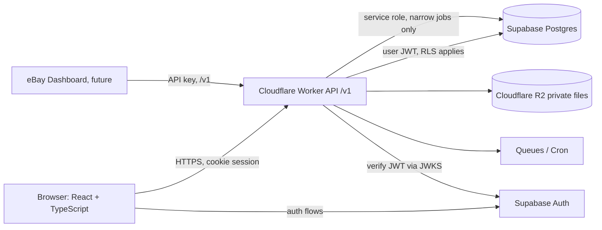

# System Architecture

| Field | Value |
|---|---|
| Version | 0.1.0 (Draft) |
| Last updated | 2026-11-26 |
| Status | Draft - pending human review |

**Purpose:** Describe the target system architecture, trust boundaries, request flow, and the technical limitations of the preferred stack that require decisions before implementation.

**Related:** `MODULE_ARCHITECTURE.md`, `DATABASE_SCHEMA.md`, `API_SPECIFICATION.md`, `AUTHORIZATION_RBAC_RLS.md`, `DEPLOYMENT.md`, `ADR-0001-stack.md`, `OPEN_QUESTIONS.md`

## 1. Principles
1. The database is the last line of defense: tenant isolation, balance and immutability are enforced in Postgres, not only in application code.
2. Modular monolith first; split only when there is a measured reason.
3. Pure domain logic (money, validation, posting rules) is isolated from I/O so it can be tested exhaustively.
4. Least privilege everywhere: users, services, CI, and AI agents.
5. Every change is versioned, reviewed and reversible or recoverable.

## 2. Context

## 3. Components
| Component | Responsibility | Notes |
|---|---|---|
| Web app | UI, input validation for UX only | No secrets, no trust. Strict CSP. |
| API Worker | AuthN verification, authZ, validation, orchestration, rate limiting | Stateless. Calls Postgres functions for all multi-step financial writes. |
| Postgres | Data, RLS, constraints, posting functions, audit chain | Source of truth for integrity rules. |
| Supabase Auth | Identity, MFA, sessions | See ADR-0004. |
| R2 | Attachments and exports | Private bucket, short-lived signed URLs, per-org key prefix. |
| Queues/Cron | Imports, report snapshots, reminders | Jobs carry `organization_id` and re-check it. |

## 4. Request flow (write)
1. Browser sends request with session cookie and CSRF token.
2. Worker verifies session, loads org membership, checks permission, validates body (schema).
3. Worker calls a Postgres function with the user's identity so RLS and function checks both apply.
4. Function runs in one transaction: re-check permission, period, balance, duplicate, then writes entry and audit event.
5. Worker returns a stable, versioned response.

## 5. Trust boundaries
Browser (untrusted) / Worker (trusted code, untrusted input) / Database (trusted, enforces rules) / third parties (untrusted). Files, CSVs, webhooks and eBay data are untrusted input.

## 6. Technical limitations and required decisions
Items marked *verify* must be checked against current Cloudflare and Supabase documentation before implementation; they come from general knowledge, not from a fresh review.
| # | Limitation | Consequence | Decision |
|---|---|---|---|
| L1 | HTTP APIs (PostgREST) cannot run a multi-statement transaction from the Worker. | Multi-line postings could half-succeed. | Do all multi-step writes inside Postgres functions (ADR-0003, OQ-022). |
| L2 | The service role key bypasses RLS. | A bug or leak exposes all tenants. | Restrict to cron/webhook jobs; every query must carry an explicit `organization_id`; code-review gate; never in the browser (ADR-0002). |
| L3 | Workers have CPU time and memory limits (*verify* current values). | Large reports could fail. | Compute aggregates in SQL; pre-aggregate by period; run heavy exports via Queues. |
| L4 | Direct Postgres from Workers needs pooling (for example Hyperdrive) (*verify*). | Connection exhaustion. | Prefer RPC over HTTPS for MVP; revisit (OQ-022). |
| L5 | supabase-js stores tokens in browser storage by default. | XSS can steal tokens. | Use API-side session cookies (BFF) (ADR-0004, OQ-015). |
| L6 | Cookie sessions require CSRF defense. | New attack surface. | SameSite=Lax/Strict, CSRF token, Origin check (`AUTH_SECURITY.md`). |
| L7 | RLS policies can hurt performance and be written wrongly. | Slow queries or leaks. | Index `organization_id`; helper functions; pgTAP tests per table (`SECURITY_TEST_CASES.md`). |
| L8 | PostgREST exposes the schemas it is configured for. | Internal functions callable by clients. | Keep internal functions in a non-exposed `private` schema; revoke default `PUBLIC` execute. |
| L9 | A single database region adds latency for edge Workers (*verify* placement options). | Slower responses. | Choose region by customer base (OQ-012); consider smart placement. |
| L10 | Backups/PITR depend on Supabase plan (*verify*). | RPO/RTO not met on a low tier. | Decide tier (OQ-016); add independent logical exports. |

## 7. Environments
local, preview (per pull request, using database branches or a disposable project), staging (production-like, anonymized data), production. No production data in lower environments. See `ENVIRONMENT_SETUP.md` and `DEPLOYMENT.md`.

## 8. Observability
Structured logs without financial payloads or secrets, request ids, metrics, alerts (see `MONITORING.md`).
